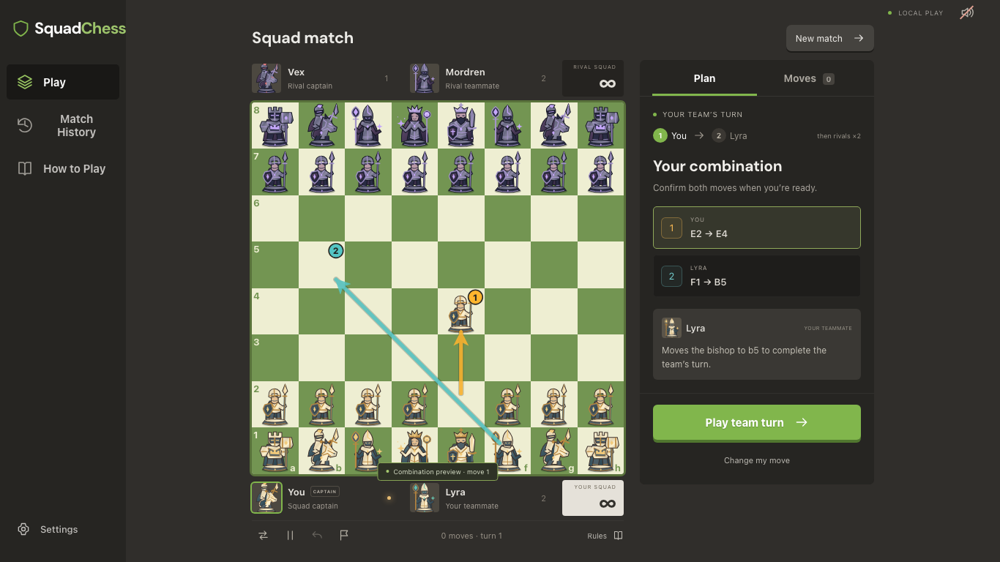

# SquadChess

**Two moves. One plan.** You and your computer teammate share an army and take two consecutive moves before the opposing computer team responds. Preview your combination, commit to it, and watch illustrated fantasy pieces battle for the board.



[Release notes](RELEASE_NOTES.md) · [Contribute](CONTRIBUTING.md) · [Report a bug](https://github.com/devSingh29/SquadChess-/issues/new/choose)

## Run locally

Use Node.js **24.22.2** and npm **11.21.2**, then run these commands from this folder. With nvm already installed, `nvm install` and `nvm use` select the recorded Node version.

```sh
npm run setup
npm run dev
```

Setup installs the exact versions recorded in the root and client lockfiles using `npm ci`. Open the local address printed by the development tool. After the first installation, `npm run dev` is the only launch command needed. Normal play runs in the browser: no Python process, game server, external AI provider, account, or API key is required. Use the same local address when returning so the browser can find your saved games.

Other commands:

```sh
npm test          # Run rules, computer-search, save, and battle tests
npm run lint     # Check source code
npm run build    # Create the release in client/dist
npm run preview  # Serve the built release locally
npm run test:e2e # Run browser checks; starts its own server when needed
npm run test:packaged # Build and test the actual release files
npm run check    # Run all source, game, browser, and packaged checks
```

Install the test browser once with `npm run test:browsers`. The browser suite starts the game at `http://localhost:5173`, or reuses an existing local server there without stopping it. It covers ordinary play, saved-game recovery, both opening modes, touch and keyboard controls, and the capture gallery.

The packaged checks build `client/dist`, start a separate server on port 4173, and play the finished bundle through its visible controls. They verify the packaged computer worker, promised follow-up, and saved-game restoration without importing development source. Keep port 4173 free for this check. Both browser suites preserve failure screenshots and traces in `client/test-results/`, with readable reports in `client/playwright-report/`.

## The rules

- Each team shares every piece of its color. By default, White opens with two moves: player one, then their teammate. The Black team then takes its two moves. The same piece may move twice.
- **Balanced opening** is an optional setup rule, off by default. When enabled, White gets one opening move and its teammate sits out that opening turn; both teams take normal two-move turns afterward. The chosen rule stays with the saved match and its replay.
- Every move must leave the moving team's king safe. **Giving check ends the team turn immediately**, forfeiting an unused second move. The opponent must escape check on its first move, then may make a second move unless its escape gives check.
- Kings are never captured. Checkmate and stalemate are decided when control passes to the other team. If there is no legal second move, that slot is skipped.
- Castling takes one move and follows ordinary safety restrictions. Promotion happens immediately and offers queen, rook, bishop, or knight; the promoted piece may move in the second slot.
- En passant is available only if a pawn's two-square advance was the previous team's final move, and only on the responding team's first move.
- Three matching positions at team-turn boundaries, bare kings, or 100 individual moves without a pawn move or capture cause a draw. The 100th move ends play immediately; checkmate takes precedence.
- Optional clocks give each team five minutes plus three seconds per completed team turn, or ten minutes plus five seconds. Planning and computer thinking use time; animations, pauses, and recovery do not. A hidden game pauses automatically. Timeout loses unless the opponent has only its king, when it draws.

You play White by default, with a Medium teammate and Easy opponents. Choosing Black lets the computer White team make the opening pair, or its single opening move when Balanced opening is enabled.

## Plan with your teammate

Select your first move to preview the resulting board and the teammate's intended follow-up. Change or cancel your choice until the combination is ready, then use **Play Team Turn**. The displayed follow-up is the one your teammate will play. A checking first move shows that the turn ends without a follow-up.

The teammate and opposing team have separate difficulty settings. Their computer search understands consecutive allied moves and the check-ending rule; it does not use an ordinary alternating-turn Stockfish evaluation. Hints propose a friendly combination, and explanations describe verified board facts. Difficulty names are relative settings, not claimed human skill ratings.

## Battles, saves, and replay

The start screen uses a familiar Chess.com-style arrangement: a large board beside match setup, a compact navigation sidebar, green action buttons, and clearly contrasting board squares. The custom fantasy characters remain easy to distinguish on that board.

Every ordinary move has character-specific travel: soldiers step or march, riders hop or vault, mages glide, stone guardians stomp, queens sweep forward, and kings take measured steps. There are two movement variations for each of the six piece roles.

Captures use twenty-four signature attacks, four per role, with reactions chosen for the defeated piece. The capturing piece, defeated piece, acting player, and saved variation determine the battle. A brief anticipation leads into the strike, contact, defeat, and settling movement. Full, reduced, and disabled motion settings are available, along with sound controls. Battle effects never change the rules.

Twelve rare environmental finishers add longer, dramatic captures lasting two to three seconds. Defeated pieces have fifteen reaction variations across the five capturable roles. Finishers and reactions are recorded for replay, with sound reproduced from the saved battle; finishers and board shake can be disabled separately. The Settings categories organize board appearance, animations, and sound, with previews. The match panel separates planning from move history, and phone confirmation controls remain close at hand.

Open **Explore capture battles** from the home screen, or **Explore the capture battles** in Settings, to visit the battle gallery. Try all six attackers, all twenty-four encounters, five target types, four player accents, and the two-capture team celebration without changing a real game.

Matches save automatically in this browser. Continue restores an unfinished position and any already-confirmed teammate move. History preserves completed games and lets you replay their original battle choices. Export a SquadChess save file for backup or transfer; import checks the entire move history before accepting it and creates a new local copy. A readable move-list export labels all four players. These are custom SquadChess records, not ordinary alternating-turn chess records.

Browser storage belongs to the browser and local address you use. Export any match you want to keep independently of that storage. If storage is unavailable or full, the game reports it and allows in-memory play and file export.

## Contributing

Start with [the contributor guide](CONTRIBUTING.md) for setup, changes, checks, and releases. Read [the architecture guide](ARCHITECTURE.md) for shared rules, match contracts, search and recovery, and [the battle guide](CONTRIBUTING_BATTLES.md) to add capture or movement sequences. Current interface screenshots are in [docs/screenshots](docs/screenshots).

GitHub Actions runs source checks, game tests, browser play, and a packaged-game check for proposed changes and updates to `main`. Successful checks provide a browser bundle and source snapshot as downloadable review artifacts. They do not publish a website or release automatically. Weekly grouped update suggestions cover the active npm packages and GitHub Actions.

SquadChess code is available under the [ISC license](LICENSE), copyright 2026 Dev Singh and contributors. Bundled fonts retain their separate license notices in `client/public/fonts/`. Original artwork and presentation contribution guidance are documented in the battle guide.

## Project layout

- `client/`: the playable React application, shared game rules, background computer search, local storage, and battle presentation.
- `server/`, `ai/`, and `shared/`: preserved source from the original online scaffold. They are not used by the current local game. The legacy server can still be started separately with `npm run dev:server` after installing its dependencies.
- Some development workspaces also retain `SquadChess-/`, the original README-only nested repository. It is excluded from the current repository; fresh clones contain the playable application and the preserved source folders above.

This version is for solo play with computer teammates and opponents. Human multiplayer, accounts, public hosting, and online rankings are not part of this release.

**Definitions:** Node.js = the program that runs the local development tools; npm = its package installer; nvm = a tool for selecting Node versions; lockfile = a record of exact package versions; React = the screen-building library; API key = a credential for an external service; browser suite = automated tests that interact with the visible game; worker = a background browser task; bundle = built game files; artifact = a downloadable output from checks; trace = a recorded test run; repository = the project and its recorded history; finisher = a rare, longer capture sequence; check = a direct threat to the king; checkmate = check with no legal escape; stalemate = no legal move without check; castling = a combined king-and-rook move; promotion = replacing a pawn at the far edge; en passant = a special immediate pawn capture; computer search = examining future moves to choose a move; scaffold = an early starting structure.
